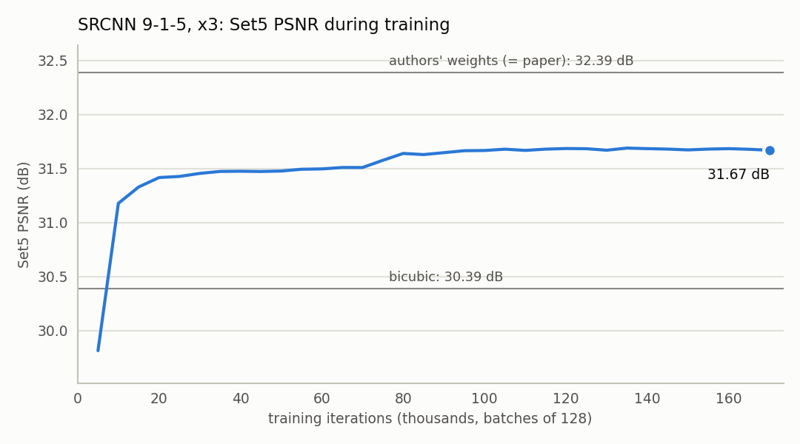
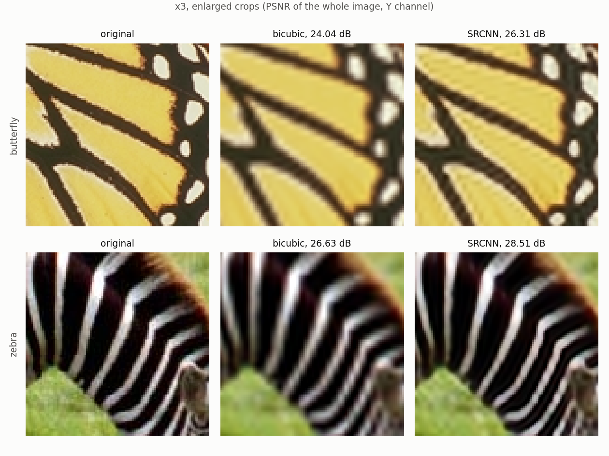

# SRCNN in PyTorch

A PyTorch implementation of the super-resolution network of Dong et al. (SRCNN): the basic 9-1-5
network, trained on the 91-image set for ×3 upscaling and evaluated with the paper's protocol. The
evaluation code reproduces the published numbers exactly when it is given the authors' released
weights, so the scores below can be compared with the paper directly.

Written as the term project of EHB 420E Artificial Neural Networks (İTÜ, January 2026) and rewritten in
November 2026.

## Results

PSNR (dB) / SSIM on the Y channel, ×3, all measured with this code:

| test set | bicubic | authors' 9-1-5 weights | this repository |
|---|---|---|---|
| Set5 (5 images) | 30.39 / 0.8682 | 32.39 / 0.9033 | 31.67 / 0.8887 |
| Set14 (14 images) | 27.54 / 0.7736 | 29.00 / 0.8145 | 28.59 / 0.8073 |
| BSD200 (200 images) | 27.70 / 0.7635 | 28.70 / 0.8020 | 28.41 / 0.7963 |

The paper reports 30.39 → 32.39 dB on Set5 and 27.54 → 29.00 dB on Set14 (bicubic → SRCNN, 9-1-5
trained on the 91 images), the numbers in the first two rows. The network trained here ends 0.72 dB
below the authors' weights on Set5, 0.41 dB on Set14 and 0.29 dB on BSD200. It saw 2.2 × 10⁷
training sub-images (170 000 batches of 128, 31 minutes on an RTX 3060 Laptop GPU); the paper's saw
8 × 10⁸. Over the last 50 000 iterations its Set5 PSNR stays between 31.67 and 31.69 dB, so the gap is
not a matter of a few more epochs.

On BSD200 the paper's bicubic baseline is 25.94 dB. The same code that reproduces Set5 and Set14 gives
27.70 dB on these 200 images (the training set of BSDS300), so the paper must have measured BSD200
differently; that row compares only methods measured here.





## What follows the paper

- **Data.** The Y channel (MATLAB's `rgb2ycbcr`) of each image, cropped to a multiple of 3, is shrunk
  and enlarged again with bicubic interpolation. [srcnn/resize.py](srcnn/resize.py) reproduces MATLAB's
  `imresize`: a cubic kernel widened by the scale when shrinking, with mirrored borders. Training uses
  33 × 33 input sub-images taken every 14 pixels and the 21 × 21 centres of the ground truth (21 884
  pairs from the 91 images), as in the authors' `generate_train.m`.
- **Network.** 9 × 9 → 1 × 1 → 5 × 5 convolutions with 64 and 32 filters and ReLU, no padding during
  training, weights drawn from N(0, 0.001), zero biases, mean squared error on the centre pixels.
- **Training.** Batches of 128, learning rate 10⁻⁴ for the first two layers and 10⁻⁵ for the last one.
  Two differences from the paper: Adam instead of SGD with momentum, and 1.7 × 10⁵ iterations
  (1000 epochs) instead of 8 × 10⁸ backpropagations. The weights after the last iteration are kept.
  Set5 PSNR is logged during training but not used to choose a checkpoint.
- **Testing.** Every layer pads its input by repeating the border pixels, so the output has the size
  of the input, as in the authors' test code. The output is rounded to 8 bits, 3 pixels are removed at
  each border, and PSNR and SSIM (11 × 11 Gaussian window) are computed on the Y channel.

## Changes from the January 2026 version

The first version was measured differently from the paper: the images were resized with PIL, the
ground truth was resized to a multiple of 3 instead of cropped (which smooths it), and 6 border
pixels were removed. That raised the bicubic baseline on Set5 from 30.39 to 30.96 dB and made
the model look as good as the paper's:

| Set5, ×3, PSNR (dB) | bicubic | SRCNN |
|---|---|---|
| January version, its own measurement | 30.96 | 32.34 |
| January weights, the paper's protocol | 30.39 | 31.65 |
| this version, the paper's protocol | 30.39 | 31.67 |
| authors' weights, the paper's protocol (the paper's number) | 30.39 | 32.39 |

Retrained on the paper's degradation, the network scores almost what the January weights score with
the paper's protocol (31.67 against 31.65 dB on Set5, 28.59 against 28.57 dB on Set14). The model
hardly changed; the measurement did.

Also fixed:

- The training script failed on import; training now uses the paper's bicubic degradation, so training
  and test inputs come from the same process.
- The checkpoint was chosen by its PSNR on Set5, which is also a test set; now the last weights are kept.
- `config.yaml` set the scale and the seed, but the scripts ignored both; every script now reads it.
- Inference used a different colour conversion from training and returned an image 12 pixels smaller
  than the bicubic one; it now uses the training conversion and returns the full size.
- The data was a Google Drive folder of about 300 single files; it now comes from the original sources
  (the authors' package and BSDS300) through a script.
- The trained weights (35 KB) are in the repository, and there are tests.

## Layout

```
srcnn/       library: MATLAB-style bicubic resizing, colour conversion, data, model, metrics, evaluation
scripts/     download_data.py, train.py, evaluate.py, make_figures.py, upscale.py
weights/     trained weights (srcnn_x3.pth)
results/     training log, scores per image, figures
tests/       pytest suite
config.yaml  settings read by every script (scale, data, network, training)
```

## Usage

```bash
pip install -r requirements.txt     # or: conda env create -f environment.yaml
```

For a CUDA build of PyTorch, install it first as described on pytorch.org.

```bash
python scripts/download_data.py     # T91, Set5, Set14, BSD200 and the authors' weights, ~50 MB
python scripts/train.py             # about 30 minutes on an RTX 3060 Laptop GPU
python scripts/evaluate.py          # writes results/x3/metrics.md, per_image.csv, summary.json
python scripts/make_figures.py
python scripts/upscale.py           # enlarges every image in inputs/ into outputs/
python -m pytest                    # the comparison with the paper runs after download_data.py
```

`--scale 2` (or 4) on train.py, evaluate.py and upscale.py works with another factor; the published
reference numbers in the code are for ×3.

## Reference

Chao Dong, Chen Change Loy, Kaiming He, Xiaoou Tang. *Image Super-Resolution Using Deep Convolutional
Networks.* IEEE TPAMI 38(2), 2016 ([arXiv:1501.00092](https://arxiv.org/abs/1501.00092)). Earlier
version: *Learning a Deep Convolutional Network for Image Super-Resolution*, ECCV 2014.
[Project page](https://mmlab.ie.cuhk.edu.hk/projects/SRCNN.html) with the code, data and weights
used here.
